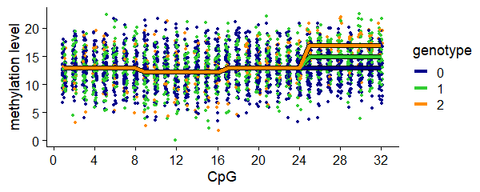
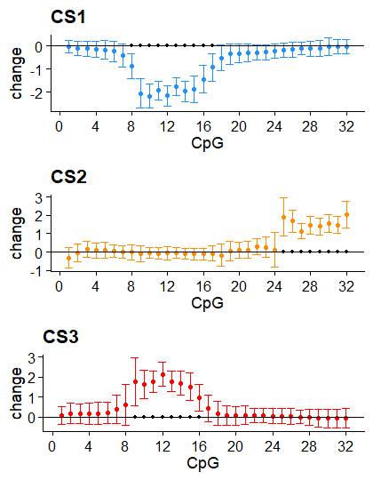
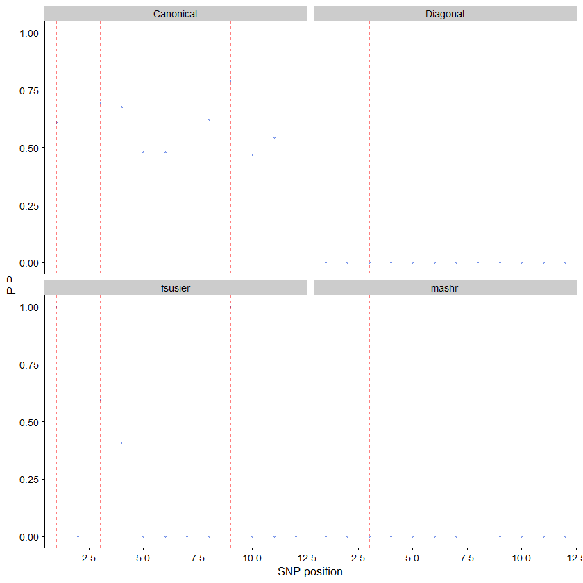

In this vignette we illustrate some of the key ideas underlying fSuSiE and how it can outperform mvsusieR for fine mapping 


We use the same set up as in the methyl_demo in fsusieR


Load the packages used in this vignette.


``` r
library(susieR)
library(fsusieR)
# 
# Attaching package: 'fsusieR'
# The following object is masked from 'package:susieR':
# 
#     get_objective
library(reshape2)
library(ggplot2)
library(cowplot)
library(mvsusieR)
# Loading required package: mashr
# Loading required package: ashr
# 
# Attaching package: 'ashr'
# The following object is masked from 'package:fsusieR':
# 
#     get_pi0
```

Set the seed so that the results can be reproduced.


``` r
set.seed(1)
```

Simulate data
-------------

We simulate a "toy" methylation data set in which the methylation
levels of 100 individuals are measured at 32 CpGs.

Among the 12 candidate SNPs, 3 SNPs affect the methylation levels: 2
SNPs affect the methylation levels of the same cluster of 8 CpGs, and
the other SNP affects the methylation levels of different cluster of 8
CpGs.


``` r
n <- 100
m <- 32
p <- 12
```

Generate the SNP minor allele frequencies (MAFs):


``` r
maf <- 0.05 + 0.45*runif(p)
```

Generate ids for SNPs and CpGs.


``` r
snpids <- paste0("SNP-",1:p)
cpgids <- paste0("CpG-",1:m)
```

Simulate the genotypes:


``` r
X <- (runif(n*p) < maf) +
     (runif(n*p) < maf)
X <- matrix(X,n,p,byrow = TRUE)
storage.mode(X) <- "double"
X[,4] <- X[,3] + 0.03*rnorm(n)
colnames(X) <- snpids
```

This is the matrix that determines how the SNP alleles change the
methylation levels. 


``` r
F <- matrix(0,p,m)
F[1,9:16] <- 2.3
F[9,9:16] <- (-2.3)
F[3,25:32] <- 2
causal <- c(1,3,9)
rownames(F) <- snpids
colnames(F) <- cpgids
```

Simulate the methylation levels at the CpGs:


``` r
E <- matrix(3*rnorm(n*m),n,m)
Y <- X %*% F
Y <- Y + E
baseline <- min(Y)
Y <- Y - baseline
```

To make the example more realistic, the methylation levels are all
simulated to be zero or higher.

To illustrate, this plot shows the effect of SNP 3 on the methylation
levels. The points show what the data look like and the lines show the
mean methylation levels for the three SNP genotypes:


``` r
pdat <- melt(Y)
x    <- X[,3]
pdat <- data.frame(cpg        = rep(1:m,each = n) +
                                runif(m*n,min = -0.2,max = 0.2),
                   meth_level = as.vector(Y),
				   geno       = factor(x))
pdat_lines <- data.frame(cpg = rep(1:m,times = 3),
                         geno = factor(rep(0:2,each = m)),
	 			 		 meth_level = rep(c(rep(0,8),rep(-0.75,8),rep(0,16)),
 						                  times = 3))
pdat_lines$meth_level <- pdat_lines$meth_level - baseline
rows <- which(with(pdat_lines,geno == 1 & cpg > 24))
pdat_lines[rows,"meth_level"] <- pdat_lines[rows,"meth_level"] + 2
rows <- which(with(pdat_lines,geno == 2 & cpg > 24))
pdat_lines[rows,"meth_level"] <- pdat_lines[rows,"meth_level"] + 4
p1 <- ggplot(pdat, aes(x = cpg, y = meth_level, color = geno)) +
  geom_point(shape = 20, size = 1.25) +
  scale_x_continuous(breaks = c(0, seq(4, 32, 4))) +
  scale_color_manual(values = c("darkblue", "limegreen", "darkorange")) +
  geom_line(data = pdat_lines, aes(x = cpg, y = meth_level, group = geno), 
            color = "black", linewidth = 1.9) +  # Black line for contrast
  geom_line(data = pdat_lines, linewidth = 1.25) +  # Original colored lines
  labs(x = "CpG", y = "methylation level", color = "genotype") +
  theme_cowplot(font_size = 11)
print(p1)
```

<div class="figure" style="text-align: center">

<p class="caption">plot of chunk plot-data</p>
</div>


## Applying fsusie


``` r
fit_TI <- susiF(Y,X,L = 10,filter_cs = FALSE )
```


fSuSiE correctly indentifies the CS and provide well calibrated effect estimates


``` r
fit_TI$cs
# [[1]]
# SNP-9 
#     9 
# 
# [[2]]
# SNP-3 SNP-4 
#     3     4 
# 
# [[3]]
# SNP-1 
#     1
```


``` r
out <- lapply(1:3,function (i) get_fitted_effect(fit_TI,l = i,cred_band = TRUE,
			                                     alpha = 0.05))
cs_colors <- c("dodgerblue","darkorange","red")
effect_plot <- function (i) {
  pdat <- data.frame(cpg      = 1:m,
                     estimate = out[[i]]$effect,
					 lower    = out[[i]]$cred_band["low",],
					 upper    = out[[i]]$cred_band["up",])
  rows <- with(pdat,which(lower > 0 | upper < 0))
  pdat2 <- data.frame(cpg = rows,estimate = 0)
  return(ggplot(pdat,aes(x = cpg,y = estimate,ymin = lower,ymax = upper)) +
         geom_point(color = cs_colors[i],size = 1) +
         geom_errorbar(color = cs_colors[i],linewidth = 0.4) +
         geom_hline(yintercept = 0,color = "black",linewidth = 0.4) +
		 geom_point(data = pdat2,mapping = aes(x = cpg,y = estimate),
		            shape = 20,color = "black",size = 1.5,
					inherit.aes = FALSE) +
         scale_x_continuous(breaks = c(0,seq(4,32,4))) +
         labs(x = "CpG",y = "change",title = paste0("CS",i)) +
		 theme_cowplot(font_size = 11))
}
plot_grid(effect_plot(1),
          effect_plot(2),
   	      effect_plot(3),
		  nrow = 3,ncol = 1)
```

<div class="figure" style="text-align: center">

<p class="caption">plot of chunk fsusie-affected-cpgs-TI</p>
</div>


## Comparison with different prior parametrization of mvsusieR


We follow the vignette of mvsusieR \url{https://stephenslab.github.io/mvsusieR/articles/prior_specification.html}
and run mvsusieR in the previous example using three main type of prior
* naive diagonal prior
* prior using  canonical correlation matrices 
* data driven prior using mashr (Urbut et al. Nature genetics 2019)

In the two first setting no CS is identified and in the last setting a CS is detected neverthe less it doesn't contains a causal SNP


Using naive prior leads to 0 credible sets


``` r
r= ncol(Y)
p= ncol(X)

Y_var <- apply(Y, 2, var)
U_diag <- 0.2 * diag(Y_var)
prior_diag <- create_mixture_prior(
  list(matrices = list(U_diag), weights = 1)
)
cat("Prior type: single diagonal matrix\n")
cat("Number of components:", prior_diag$n_component, "\n")
# Prior type: single diagonal matrix
# Number of components:
fit_diag <- mvsusie(X, Y, L = 10,
                    prior_variance = prior_diag,
                    estimate_prior_variance = TRUE,
                    verbose = FALSE,
                    standardize = TRUE)
 
cat("Credible sets:", length(fit_diag$sets$cs), "\n")
# Prior type: single diagonal matrix
# Number of components: 
# Credible sets: 0
```


Using canonical prior lead to 0 cs


``` r
prior_canon <- create_mixture_prior(R = r)
cat("Components:", prior_canon$n_component, "\n")
 fit_canon <- mvsusie(X, Y, L = 10,
                     prior_variance = prior_canon,
                     estimate_prior_variance = TRUE,
                    verbose = FALSE,
                     standardize = TRUE) 
cat("Credible sets:", length(fit_canon$sets$cs), "\n")
 
# Components: 
# Credible sets: 0
```


Data driven approach leads to a single cs (instead of 3)


``` r
# Compute z-scores for mashr
Z <- calc_z(X, Y, center = TRUE, scale = TRUE)

# Set up mashr data
mash_data <- mashr::mash_set_data(Bhat = Z,
                                  Shat = matrix(1, p, r))

# Fit mashr (simplified for this example)
U_c <- mashr::cov_canonical(mash_data)
m_fit <- mashr::mash(mash_data, Ulist = U_c, outputlevel = 0)

# Create prior from mashr output
prior_mash <- create_mixture_prior(fitted_g = m_fit$fitted_g)
cat("Components from mashr:", prior_mash$n_component, "\n")
 fit_mash <- mvsusie(X, Y, L = 10,
                    prior_variance = prior_mash,
                    estimate_prior_variance = TRUE,
                    verbose = FALSE,
                    standardize = TRUE) 
cat("Credible sets:", length(fit_mash$sets$cs), "\n")
#  - Computing 12 x 556 likelihood matrix.
#  - Likelihood calculations took 0.00 seconds.
#  - Fitting model with 556 mixture components.
#  - Model fitting took 0.02 seconds.
# Components from mashr: 
# Credible sets: 1
```


``` r
pdat <- data.frame(
  pip = c(fit_diag$pip, fit_canon$pip, fit_mash$pip,fit_TI$pip),
  prior = rep(c("Diagonal", "Canonical", "mashr", "fsusier"),
              each = p),
  pos = rep(seq_len(p), 4)
)
ggplot(pdat, aes(x = pos, y = pip)) +
  geom_point(shape = 20, size = 1, color = "royalblue", alpha = 0.5) +
  facet_wrap(~prior) +
  geom_vline(xintercept = causal, linetype = "dashed",
             color = "red", alpha = 0.5) +
  labs(x = "SNP position", y = "PIP") +
  theme_cowplot(font_size = 10)
```

<div class="figure" style="text-align: center">

<p class="caption">plot of chunk unnamed-chunk-3</p>
</div>

