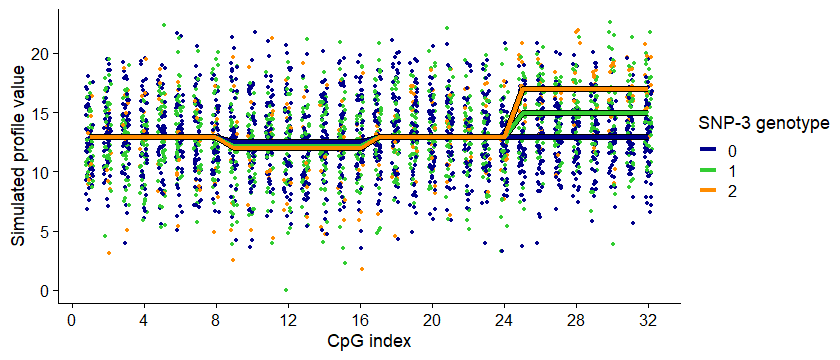
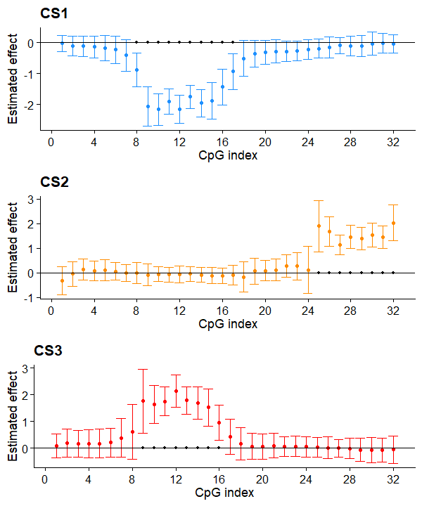
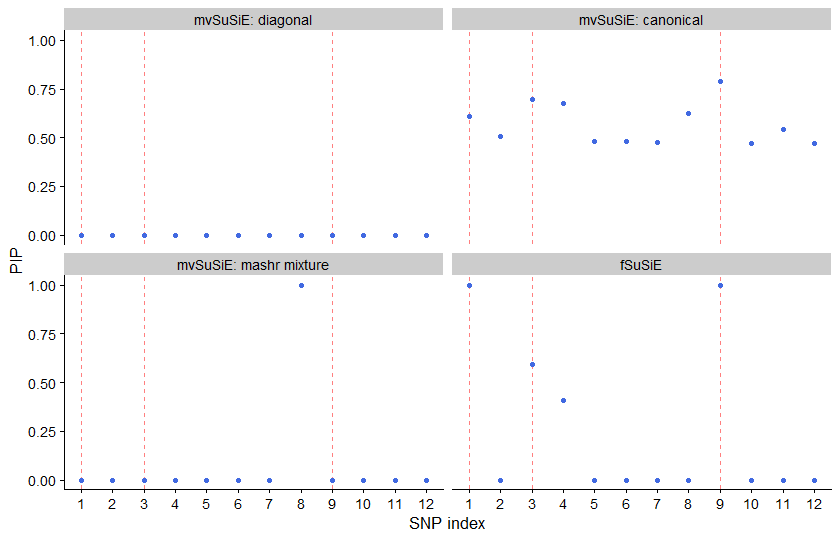

This vignette compares fSuSiE and mvSuSiE in a small simulated example
where genetic effects are confined to contiguous blocks of CpGs and
change abruptly at block boundaries. We use the simulation setup from
the [methylation vignette](methyl_demo.html) in **fsusieR**.

mvSuSiE is a flexible method for jointly fine-mapping multiple traits,
implemented in **mvsusieR**. Its effect prior describes patterns of
sharing across traits. With suitable covariance patterns, this framework
can accommodate smoothly varying effects, as well as localized or
step-shaped effects. However, its standard prior choices do not
explicitly use the genomic ordering of the measurements. In particular,
borrowing information across a contiguous block of CpGs requires a prior
that adequately represents that pattern of sharing.

fSuSiE is designed for functional phenotypes: measurements indexed by
position, with genetic effects that vary along the profile. Its wavelet
representation can describe both smooth changes and abrupt, localized
changes using a sparse set of coefficients. This provides a way to model
spatial structure without specifying each affected block in advance.

Here, we examine how three mvSuSiE prior specifications perform on a
profile with step-shaped effects. This is an illustration of the fitted
configurations on one dataset. It does not establish that mvSuSiE cannot
recover step-shaped effects, or that it generally performs better on
smooth effects; the latter comparison would require simulations that
vary effect shape while controlling the other modeling choices.


Load the packages and set the random seed.


``` r
library(susieR)
library(fsusieR)
library(ggplot2)
library(cowplot)
library(mvsusieR)
```


``` r
set.seed(1)
```

## Simulating profiles with step-shaped effects

We simulate 100 individuals, 32 ordered CpGs, and 12 candidate SNPs.
Three SNPs have nonzero effects: SNP-1 and SNP-9 affect CpGs 9--16 in
opposite directions, while SNP-3 affects CpGs 25--32. Within each
affected block, the effect is constant; outside the block, it is zero.


``` r
n <- 100
m <- 32
p <- 12
```

Generate minor allele frequencies and identifiers.


``` r
maf <- 0.05 + 0.45 * runif(p)
```


``` r
snpids <- paste0("SNP-", 1:p)
cpgids <- paste0("CpG-", 1:m)
```

Generate the genotype matrix. To introduce fine-mapping uncertainty,
we replace SNP-4 with a slightly perturbed copy of SNP-3. This produces
a highly correlated, noncausal candidate. The perturbed values are a
continuous genotype surrogate for this toy example, rather than literal
allele counts.


``` r
X <- (runif(n * p) < maf) + (runif(n * p) < maf)
X <- matrix(X, n, p, byrow = TRUE)
storage.mode(X) <- "double"
X[, 4] <- X[, 3] + 0.03 * rnorm(n)
colnames(X) <- snpids
```

Define the effect matrix. Each row is the effect of one SNP across the
ordered CpGs, in the original measurement coordinates.


``` r
F <- matrix(0, p, m)
F[1, 9:16] <- 2.3
F[9, 9:16] <- -2.3
F[3, 25:32] <- 2
causal <- c(1, 3, 9)
rownames(F) <- snpids
colnames(F) <- cpgids
```

Simulate the profiles as `Y = X %*% F + E`, with independent Gaussian
residuals of variance 9. We shift all observations by a common constant
to make the displayed values nonnegative. These are continuous
methylation-like measurements, not methylation proportions constrained
to lie between zero and one.


``` r
E <- matrix(3 * rnorm(n * m), n, m)
Y <- X %*% F
Y <- Y + E
baseline <- min(Y)
Y <- Y - baseline
```

The points below show the simulated measurements, colored by SNP-3
genotype. The lines show the average noiseless profile within each
genotype group, including the contributions of the other causal SNPs.
The separation at CpGs 25--32 reflects the step-shaped effect of SNP-3.


``` r
x <- X[, 3]
pdat <- data.frame(
  cpg = rep(1:m, each = n) + runif(m * n, min = -0.2, max = 0.2),
  meth_level = as.vector(Y),
  geno = factor(x)
)
Y_mean <- X %*% F - baseline
pdat_lines <- aggregate(
  as.vector(Y_mean),
  by = list(cpg = rep(1:m, each = n),
            geno = factor(rep(x, times = m))),
  FUN = mean
)
names(pdat_lines)[3] <- "meth_level"
p1 <- ggplot(pdat, aes(x = cpg, y = meth_level, color = geno)) +
  geom_point(shape = 20, size = 1.25) +
  scale_x_continuous(breaks = c(0, seq(4, 32, 4))) +
  scale_color_manual(values = c("darkblue", "limegreen", "darkorange")) +
  geom_line(data = pdat_lines, aes(group = geno),
            color = "black", linewidth = 1.9) +
  geom_line(data = pdat_lines, linewidth = 1.25) +
  labs(x = "CpG index", y = "Simulated profile value", color = "SNP-3 genotype") +
  theme_cowplot(font_size = 11)
print(p1)
```

<div class="figure" style="text-align: center">

<p class="caption">plot of chunk plot-data</p>
</div>

## Applying fSuSiE

We fit fSuSiE with up to ten single effects. The output below lists its
credible sets (CSs). For this illustration, `filter_cs = FALSE` retains
the sets without the optional fSuSiE CS filtering step.


``` r
fit_TI <- fsusieR::susiF(Y, X, L = 10, filter_cs = FALSE)
```


``` r
fit_TI$cs
# [[1]]
# SNP-9 
#     9 
# 
# [[2]]
# SNP-3 SNP-4 
#     3     4 
# 
# [[3]]
# SNP-1 
#     1
```

In this run, fSuSiE returns three credible sets: one containing SNP-9,
one containing SNP-3 and SNP-4, and one containing SNP-1. Each set
contains a causal SNP. The set containing both SNP-3 and SNP-4 reflects
the difficulty of distinguishing these highly correlated candidates.

The plots below show the estimated effect profiles for the three
components, with nominal 95% pointwise credible intervals. Black points
mark CpGs whose intervals exclude zero. The profiles recover the affected
blocks in this example; assessing interval calibration would require
repeated simulations.


``` r
out <- lapply(1:3, function(i) {
  get_fitted_effect(fit_TI, l = i, cred_band = TRUE, alpha = 0.05)
})
cs_colors <- c("dodgerblue", "darkorange", "red")
effect_plot <- function(i) {
  pdat <- data.frame(cpg = 1:m,
                     estimate = out[[i]]$effect,
                     lower = out[[i]]$cred_band["low", ],
                     upper = out[[i]]$cred_band["up", ])
  rows <- with(pdat, which(lower > 0 | upper < 0))
  pdat2 <- data.frame(cpg = rows, estimate = 0)
  ggplot(pdat, aes(x = cpg, y = estimate, ymin = lower, ymax = upper)) +
    geom_point(color = cs_colors[i], size = 1) +
    geom_errorbar(color = cs_colors[i], linewidth = 0.4) +
    geom_hline(yintercept = 0, color = "black", linewidth = 0.4) +
    geom_point(data = pdat2, aes(x = cpg, y = estimate),
               shape = 20, color = "black", size = 1.5,
               inherit.aes = FALSE) +
    scale_x_continuous(breaks = c(0, seq(4, 32, 4))) +
    labs(x = "CpG index", y = "Estimated effect", title = paste0("CS", i)) +
    theme_cowplot(font_size = 11)
}
plot_grid(effect_plot(1), effect_plot(2), effect_plot(3),
          nrow = 3, ncol = 1)
```

<div class="figure" style="text-align: center">

<p class="caption">plot of chunk fsusie-affected-cpgs</p>
</div>

## Applying mvSuSiE with different effect priors

Following the
[mvSuSiE prior-specification vignette](https://stephenslab.github.io/mvsusieR/articles/prior_specification.html),
we consider three choices: a single diagonal covariance matrix, a mixture
of canonical covariance matrices, and a mixture fitted with **mashr**
using canonical covariance matrices. All three fits use the same data
and allow up to ten single effects. We retain the default mvSuSiE
residual-covariance and CS-filtering settings and show PIPs alongside CS
counts. These comparisons vary the effect prior within mvSuSiE; they do
not match residual-covariance estimation between mvSuSiE and fSuSiE.

### A diagonal effect prior

This prior treats effects at different CpGs as independent a priori.
Its overall scale is estimated during fitting, but its diagonal
structure does not encode coordinated effects within contiguous blocks.


``` r
r <- ncol(Y)
Y_var <- apply(Y, 2, var)
U_diag <- 0.2 * diag(Y_var)
prior_diag <- create_mixture_prior(
  list(matrices = list(U_diag), weights = 1)
)
fit_diag <- mvsusie(X, Y, L = 10,
                    prior_variance = prior_diag,
                    estimate_prior_variance = TRUE,
                    verbose = FALSE,
                    standardize = TRUE)
cat("Credible sets:", length(fit_diag$sets$cs), "\n")
# Credible sets: 0
```

### A canonical mixture prior

The canonical prior includes trait-specific and shared-effect patterns.
It allows more flexible sharing than the single diagonal prior, but
does not specifically encode the adjacency of CpGs or the affected
blocks in this simulation.


``` r
prior_canon <- create_mixture_prior(R = r)
fit_canon <- mvsusie(X, Y, L = 10,
                     prior_variance = prior_canon,
                     estimate_prior_variance = TRUE,
                     verbose = FALSE,
                     standardize = TRUE)
cat("Credible sets:", length(fit_canon$sets$cs), "\n")
# Credible sets: 0
```

### A mixture fitted with mashr

Here, **mashr** estimates mixture weights over canonical covariance
patterns and their scaled versions, using the marginal association
z-scores from this locus. The weights are learned from the data; the
covariance patterns themselves are not learned as new spatial patterns.
This small example also provides only 12 SNPs, including a highly
correlated pair, for fitting the mixture. It therefore does not represent
the richer prior-learning strategy possible with many association
signals across regions sharing the same trait definitions.


``` r
Z <- calc_z(X, Y, center = TRUE, scale = TRUE)
mash_data <- mashr::mash_set_data(Bhat = Z, Shat = matrix(1, p, r))
U_c <- mashr::cov_canonical(mash_data)
m_fit <- mashr::mash(mash_data, Ulist = U_c, outputlevel = 0)
prior_mash <- create_mixture_prior(fitted_g = m_fit$fitted_g)
fit_mash <- mvsusie(X, Y, L = 10,
                    prior_variance = prior_mash,
                    estimate_prior_variance = TRUE,
                    verbose = FALSE,
                    standardize = TRUE)
cat("Credible sets:", length(fit_mash$sets$cs), "\n")
#  - Computing 12 x 556 likelihood matrix.
#  - Likelihood calculations took 0.00 seconds.
#  - Fitting model with 556 mixture components.
#  - Model fitting took 0.02 seconds.
# Credible sets: 1
```

## Comparing the fitted results

The table reports the CSs returned by each configuration. SNP-1, SNP-3,
and SNP-9 are causal; SNP-4 is the highly correlated noncausal candidate.
The counts use each method's filtering settings shown above.


``` r
cs_list <- list(
  "mvSuSiE: diagonal" = fit_diag$sets$cs,
  "mvSuSiE: canonical" = fit_canon$sets$cs,
  "mvSuSiE: mashr mixture" = fit_mash$sets$cs,
  "fSuSiE" = fit_TI$cs
)
format_cs <- function(sets) {
  if (length(sets) == 0L) return("None")
  paste(vapply(sets, function(s) {
    paste0("{", paste(snpids[s], collapse = ", "), "}")
  }, character(1)), collapse = "; ")
}
cs_summary <- data.frame(
  Method = names(cs_list),
  Number_of_CSs = lengths(cs_list),
  Credible_sets = vapply(cs_list, format_cs, character(1)),
  row.names = NULL
)
knitr::kable(cs_summary,
             col.names = c("Method", "Number of CSs", "Credible sets"))
```


|Method                 | Number of CSs|Credible sets                    |
|:----------------------|-------------:|:--------------------------------|
|mvSuSiE: diagonal      |             0|None                             |
|mvSuSiE: canonical     |             0|None                             |
|mvSuSiE: mashr mixture |             1|{SNP-8}                          |
|fSuSiE                 |             3|{SNP-9}; {SNP-3, SNP-4}; {SNP-1} |


Neither the diagonal nor the canonical mvSuSiE fit returns a credible
set in this run. Their PIPs differ, however: the diagonal fit assigns
essentially no inclusion probability to the SNPs, whereas the canonical
fit assigns diffuse inclusion probabilities across the candidates. The
mixture fitted with mashr returns one CS containing SNP-8, which is not
causal in this simulation.

The plot below compares SNP posterior inclusion probabilities (PIPs).
Red dashed lines identify the three causal SNPs. The horizontal axis is
the SNP index, not genomic distance.


``` r
method_labels <- c("mvSuSiE: diagonal", "mvSuSiE: canonical",
                   "mvSuSiE: mashr mixture", "fSuSiE")
pdat <- data.frame(
  pip = c(fit_diag$pip, fit_canon$pip, fit_mash$pip, fit_TI$pip),
  method = factor(rep(method_labels, each = p), levels = method_labels),
  pos = rep(seq_len(p), 4)
)
ggplot(pdat, aes(x = pos, y = pip)) +
  geom_vline(xintercept = causal, linetype = "dashed",
             color = "red", alpha = 0.5) +
  geom_point(shape = 20, size = 2, color = "royalblue") +
  facet_wrap(~method) +
  scale_x_continuous(breaks = seq_len(p)) +
  scale_y_continuous(limits = c(0, 1)) +
  labs(x = "SNP index", y = "PIP") +
  theme_cowplot(font_size = 10)
```

<div class="figure" style="text-align: center">

<p class="caption">plot of chunk compare-pips</p>
</div>

## Interpretation

In this example, fSuSiE recovers all three causal signals, retaining
uncertainty between SNP-3 and its highly correlated neighbor. The three
mvSuSiE configurations do not recover the same signals. This illustrates
a practical difficulty that can arise when applying standard multivariate
prior choices to localized, step-shaped genetic effects.

mvSuSiE can accommodate smooth changes when its prior captures the
relevant sharing patterns, and a suitably specified prior could also
capture step-shaped changes. The distinction is that its standard
specifications do not explicitly use the functional ordering of the
phenotype, whereas fSuSiE uses that ordering through its wavelet
representation. Sharing effects across traits and adapting to the
locations of abrupt changes are related but different modeling tasks.

These results concern one dataset and the configurations shown here.
They do not determine whether the observed differences arise primarily
from effect-prior specification, residual-covariance estimation, or
optimization. Establishing those contributions, and comparing smooth
with step-shaped effects, requires replicated simulations that vary
these factors separately.

## Session information


``` r
sessionInfo()
# R version 4.6.1 (2026-06-24 ucrt)
# Platform: x86_64-w64-mingw32/x64
# Running under: Windows 11 x64 (build 26300)
# 
# Matrix products: default
#   LAPACK version 3.12.1
# 
# locale:
# [1] C
# system code page: 65001
# 
# time zone: Europe/Oslo
# tzcode source: internal
# 
# attached base packages:
# [1] stats     graphics  grDevices utils     datasets  methods   base     
# 
# other attached packages:
# [1] mvsusieR_0.3.0 mashr_0.2.79   ashr_2.2-63    cowplot_1.2.0  ggplot2_4.0.3 
# [6] fsusieR_0.3.59 susieR_0.16.6 
# 
# loaded via a namespace (and not attached):
#  [1] generics_0.1.4     bitops_1.1-0       smashr_1.3-12      lattice_0.22-9    
#  [5] rmeta_3.0          caTools_1.18.4     magrittr_2.0.5     evaluate_1.0.5    
#  [9] grid_4.6.1         RColorBrewer_1.1-3 mvtnorm_1.4-2      plyr_1.8.9        
# [13] Matrix_1.7-5       ggrepel_0.9.8      reshape_0.8.10     mixsqp_0.3-54     
# [17] scales_1.4.0       truncnorm_1.0-9    invgamma_1.2       abind_1.4-8       
# [21] cli_3.6.6          rlang_1.2.0        zigg_0.0.2         crayon_1.5.3      
# [25] deconvolveR_1.2-1  splines_4.6.1      withr_3.0.3        otel_0.2.0        
# [29] ebnm_1.1-42        tools_4.6.1        SQUAREM_2026.1     dplyr_1.2.1       
# [33] wavethresh_4.7.3   Rfast_2.1.5.2      assertthat_0.2.1   vctrs_0.7.3       
# [37] R6_2.6.1           matrixStats_1.5.0  lifecycle_1.0.5    MASS_7.3-65       
# [41] trust_0.1-9        irlba_2.3.7        pkgconfig_2.0.3    RcppParallel_6.2.0
# [45] pillar_1.11.1      gtable_0.3.6       data.table_1.18.4  glue_1.8.1        
# [49] Rcpp_1.1.1-1.1     xfun_0.60          tibble_3.3.1       tidyselect_1.2.1  
# [53] knitr_1.51         farver_2.1.2       labeling_0.4.3     compiler_4.6.1    
# [57] S7_0.2.2
```
